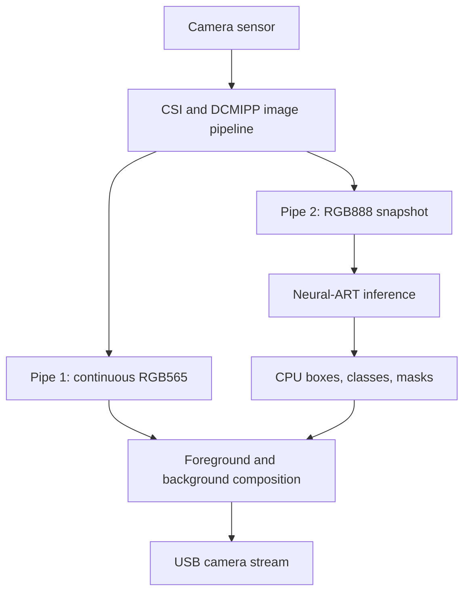

# STM32N6 computer vision architecture

Follow one frame from the camera to the USB viewer, then follow one model from training to flash. The examples use the NUCLEO-N657X0-Q and the 256 × 256 YOLOv8n-seg network in this repository. [The README](../README.md) has the commands to build and run the demo. Open the [source walkthrough](Source-Walkthrough.md) for line-by-line VS Code links and a map of the model settings.

## 1. Start with three pieces of the system

| Piece | What it does | Where to start reading |
| --- | --- | --- |
| Python training and export | Learns model weights from labeled images. Exports an inference graph and quantizes the values used during inference. | [Notebook 01](../Notebooks/01_Train_and_Quantize_STM32N6.ipynb) |
| ST Edge AI Core on the PC | Compiles the TFLite graph for the Neural-ART accelerator, decides where tensors and constants will live, and emits C code and flash data. | [Generation script](../Model/generate-n6-model_NUCLEO-N657X0-Q.sh) and [Notebook 02](../Notebooks/02_Compile_and_Deploy_NUCLEO_N6.ipynb) |
| Firmware on the STM32N6 | Captures images, invokes the compiled network, decodes the tensors, and draws the results. The Cortex-M55 runs the application and postprocessing. The NPU accelerates supported graph operations. | [`main.c`](../Application/NUCLEO-N657X0-Q/Src/main.c) |

An **inference** is one forward pass from an input image to output tensors using fixed weights. A **tensor** is a typed array whose shape and layout describe how to read its values. **Postprocessing** turns those arrays into objects with boxes, class IDs, scores, and masks.

## 2. Follow one image through the firmware

### DCMIPP and ISP

The sensor supplies camera data over CSI. DCMIPP is the STM32N6 camera pipeline. Its image signal processor (ISP) and downstream pipes prepare images for the application. The camera middleware configures the sensor and pipeline, and `CameraPipeline_IspUpdate()` calls `CMW_CAMERA_Run()` to service the ISP. The two outputs share the camera source and can use different formats and dimensions. [STM32N6 reference manual, RM0486](https://www.st.com/resource/en/reference_manual/rm0486-stm32n647657xx-armbased-32bit-mcus-stmicroelectronics.pdf)

| Setting | Pipe 1 | Pipe 2 |
| --- | --- | --- |
| Purpose | Background video for display | Input tensor for inference |
| Capture mode | Continuous | One snapshot per inference loop |
| Pixel format in this build | RGB565, 2 bytes per pixel | RGB888, 3 bytes per pixel |
| Output size | Computed for the display | From the generated `STAI_NETWORK_IN_1_*` macros |
| Destination | `lcd_bg_buffer` | `nn_in` directly when pitch matches, or a temporary buffer otherwise |

**Pitch** is the number of bytes from one row start to the next. At 256 pixels wide, a densely packed RGB888 row takes `256 × 3 = 768` bytes. The whole input takes `256 × 768 = 196,608` bytes, or 192 KiB. If a different width produces a larger hardware pitch, the application captures to `dcmipp_out_nn` and calls `img_crop()` to copy the valid pixels into tightly packed rows. That step deals with row padding. Image framing and resizing are set in `app_camerapipeline.c`.

The default `ASPECT_RATIO_FULLSCREEN` selects the fullscreen path for display and the FIT path for inference. The inference path resizes the camera field into a square, so an object can change aspect ratio. For a fair PC-to-board tensor comparison use identical RGB bytes. A desktop resize is useful for a visual check, but the ISP and resampling may differ.

### Where to pause in the debugger

| Order | Function or landmark | What to inspect |
| --- | --- | --- |
| 1 | `Hardware_init()` | Clocks, UART, NPU RAM and cache, external NOR in memory-mapped mode, peripheral access attributes. |
| 2 | `NeuralNetwork_init()` | `stai_runtime_init()` initializes the runtime. `stai_network_init()` initializes the network instance. The getters provide the actual input and output addresses and sizes. |
| 3 | `CameraPipeline_Init()` | Compare the generated input dimensions, the camera's negotiated dimensions, and `pitch_nn`. |
| 4 | `CameraPipeline_NNPipe_Start()` and `CMW_CAMERA_PIPE_FrameEventCallback()` | The foreground loop starts a snapshot. The Pipe 2 frame callback increments `cameraFrameReceived`. Read the input buffer after capture completion. |
| 5 | `Run_Inference()` | `stai_network_run(..., STAI_MODE_ASYNC)` advances inference. If the runtime requests it, the CPU waits for an event and re-enters the runtime. The main loop waits for this call to finish before decoding. |
| 6 | `app_postprocess_run()` | Inspect raw detection and prototype buffers at entry and the decoded objects at exit. |
| 7 | `Display_NetworkOutput()` | Converts normalized boxes to display coordinates, draws into a double-buffered foreground, cleans the cache for the written buffer, and reloads the layer. |

The CPU, camera, display, and NPU access shared memory. A **cache clean** writes dirty CPU cache lines back to RAM. An **invalidate** discards cached lines so subsequent CPU reads can see updated RAM. Follow the buffer's producer, consumer, and ownership transition before moving a cache operation. Buffer addresses, pitch, and cache-line alignment matter independently.

Open [the main loop](../Application/NUCLEO-N657X0-Q/Src/main.c#L161) and [the camera implementation](../Application/NUCLEO-N657X0-Q/Src/app_camerapipeline.c) side by side. The UART console uses 115200 baud, 8N1. The displayed inference timer surrounds `Run_Inference()`. It excludes camera wait, postprocessing, and drawing. For throughput, timestamp the full loop at those boundaries and report inference and frame latency separately.

## 3. Read the model interface by hand

**Input.** One image, 256 rows, 256 columns, and 3 channels, stored as NHWC `[1, 256, 256, 3]`. The camera supplies interleaved RGB bytes. The TFLite host model uses signed `int8` with scale about 1/255 and zero point −128. The generated firmware interface uses `uint8` with scale about 1/255 and zero point 0.

**Worked example.** An RGB channel byte of 128 represents approximately `128 / 255 = 0.502`. The host TFLite receives signed value `0` and reconstructs `(0 - (-128)) / 255`. The generated firmware interface receives unsigned value `128` and reconstructs `(128 - 0) / 255`. On a different model, read the generated scale and zero point before feeding it raw pixels.

| Output | COCO TFLite shape | What the firmware reads |
| --- | --- | --- |
| Candidate detections | `[1, 116, 1344]` | 116 attribute rows by 1,344 candidates in a flat buffer. The generated ST header reports this buffer as `[116, 1344, 1]`. |
| Mask prototypes | `[1, 64, 64, 32]` | A shared 64 × 64 grid of 32 prototype values per pixel with channels last. |

For this graph, the detection head covers grids of 32 × 32, 16 × 16, and 8 × 8, for a total of 1,344 candidates. Each candidate has four box values, 80 class scores, and 32 mask coefficients. Using one class with the same head changes the attribute count to `4 + 1 + 32 = 37`. The contract includes normalized center coordinates and dimensions, class-score semantics, output order, signedness, and memory layout. Matching element counts alone can't establish compatibility.

**Example index.** In the detection buffer, attribute `a` for candidate `i` is at flat offset `a * 1344 + i`. In the prototype buffer, channel `k` at pixel `(x, y)` is at `(y * 64 + x) * 32 + k`. Start with these two formulas when comparing Python and C.

### How a candidate becomes a mask

1. Find the highest-scoring class for the candidate and apply the confidence threshold. With COCO's detection scale of approximately 0.02002 and zero point 25, raw score 55 corresponds to about 0.601. A confidence threshold of 0.5 maps to approximately raw value 50 in the bundled decoder.
2. Apply **non-maximum suppression (NMS)** per class. NMS suppresses a lower-scoring box when it overlaps a higher-scoring box above the configured intersection-over-union (IoU) threshold. IoU is intersection area divided by union area. The demo defaults are 0.5 confidence, 0.4 IoU, and at most 10 returned objects.
3. Reconstruct a binary mask for each retained detection. At each prototype-grid pixel, take a dot product of the candidate's 32 coefficients with the 32 prototype values there. The C implementation subtracts the corresponding zero points, accumulates integer products, and compares the sum against a threshold derived from the two scales. The display clips the mask overlay to its corresponding box.
4. Map normalized box coordinates to display dimensions. For a model-space box centered at `(0.5, 0.5)` with width `0.25`, its left edge is `(0.5 - 0.25/2) × 256 = 96` model pixels. Use the inverse of the actual preprocessing transform when mapping results to the sensor image, especially if you crop, pad, or mirror.

Read [the adapter](../Middlewares/ai-postprocessing-wrapper/app_postprocess_iseg_yolo_v8_ui.c) for tensor order and configuration, and [the decoder](../Middlewares/stm32-vision-models-postprocessing/lib_vision_models_pp/Src/iseg_pp_yolov8.c) for indexing, NMS, and mask reconstruction. The adapter currently reads both output quantization pairs from [`app_config.h`](../Application/NUCLEO-N657X0-Q/Inc/app_config.h). Regenerating the network does not update those definitions.

## 4. Follow a model from the notebook into flash

| File | What it contains | Who consumes it |
| --- | --- | --- |
| `best.pt` | The best checkpoint selected by validation during training | Ultralytics evaluation and export |
| `*_full_integer_quant.tflite` | Portable inference graph, weights, and quantization metadata | PC interpreter and ST Edge AI Core |
| `network.c` and `network_ecblobs.h` | Generated execution code and accelerator data for this graph | Arm firmware build |
| `stai_network.c` and `stai_network.h` | Generated interface, context, and tensor definitions | App, camera pipeline, and ST runtime |
| `network_atonbuf.xSPI2.raw` | Bytes for model constants in the xSPI flash pool | `objcopy` |
| `network_data.hex` | The same model data in Intel HEX with its flash destination encoded | STM32CubeProgrammer |
| `network_generate_report.txt` | Memory allocations, graph details, and compiler execution breakdown | Developer reviewing placement and operator support |

`stedgeai generate` emits the model-specific execution plan and byte data. The Arm build compiles the generated C together with the firmware. `objcopy` packages the external data bytes with address `0x70380000`. CubeProgrammer then writes those records to the board. The firmware calls the generated code and accesses the model data through memory-mapped NOR. Keep the C/H files and HEX from the same generation.

### Two memory descriptions must agree

| Memory description | Sets the placement of | How to verify |
| --- | --- | --- |
| [Firmware linker script](../Application/NUCLEO-N657X0-Q/STM32CubeIDE/STM32N657xx.ld) | Application code, globals, stack and heap, including display and decoding buffers | Build `.map` and linker memory summary |
| [Neural-ART memory pool](../Model/my_mpools/stm32n6-app2_NUCLEO-N657X0-Q.mpool) | Network activation and constant placement for `stedgeai` | [Generation report](../Model/st_ai_output/network_generate_report.txt) |

**Weights** are fixed model parameters. **Activations** are intermediate values created during a forward pass. The current application linker region begins at `0x34000400` and ends before `0x3419C000`. The model pool's 400 KiB CPU-side SRAM region starts at `0x3419C000`. This boundary is an agreement between two tools. Moving it in one file alone can create overlapping allocations. The bundled report shows about 3.314 MiB of constants in external flash and 445 of 448 KiB in one active NPU SRAM bank. Summing free memory across banks can hide placement limits. Compare the actual used ranges and look for software or hybrid epochs when investigating latency. [ST Neural-ART compiler primer](https://stedgeai-dc.st.com/assets/embedded-docs/stneuralart_neural_art_compiler.html)

### Boot and deployment

On a flash boot, the boot ROM loads the first-stage bootloader (FSBL). This project's FSBL loads the app for execution in SRAM. The app initializes and maps the NOR holding the network data. Flash locations identify where images are programmed. Linker addresses identify where the application runs.

| Flash start | Contents | When to update |
| --- | --- | --- |
| `0x70000000` | `FSBL/ai_fsbl.hex` | Initial setup or a bootloader change |
| `0x70100000` | Application image with a boot header and generated network code | Firmware or generated network change |
| `0x70380000` | `network_data.hex` | Model regeneration |

During SRAM debugging, the debugger loads the application ELF. The model's external constants still need to be present. The [README flash section](../README.md#6-program-external-flash) gives the actual programming commands, boot jumper positions, and erase behavior.

## 5. Work through three checks

| Check | Do this | Evidence to keep |
| --- | --- | --- |
| Camera to tensor | Run the bundled demo, pause after the Pipe 2 snapshot, and inspect `pitch_nn` and the first few rows of `nn_in`. | Shape, row pitch, channel order, and a known board input. |
| Tensor to objects | Run the COCO notebook, inspect one raw candidate, and then watch the app decode a known object. | Both output shapes, quantization pairs, decoded class and box, and the final mask. For numeric parity, use the same input bytes. |
| One custom model | Export a one-class model, compare it with the PyTorch checkpoint, generate the STM32 version, and program matching app and network data. | Validation metrics, generation report, linker map, UART model name, and results on positive and empty captures. |

If the host model fails on the same scene, inspect labels, training, or quantization first. If it works on the host and fails only on the board, check RGB order and framing, generated files and programmed weights, and then the decoder parameters. To debug slow frames, measure capture, inference, postprocessing, and display separately.
